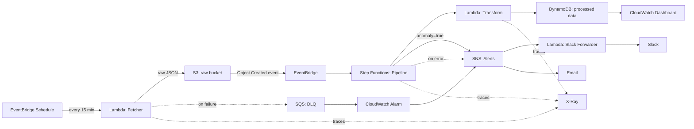

# PipelineWatch

A serverless, event-driven data pipeline on AWS, provisioned entirely with
Terraform and deployed via CI/CD. It ingests live weather data on a
schedule, processes it through an orchestrated workflow, flags anomalies,
and alerts on both **data anomalies** and **pipeline failures** — with an
observability dashboard and a documented cost-optimization pass.

## Why this project exists

Most portfolio pipelines stop at "data goes in, data comes out." This one
is built to answer the questions a DevOps interview actually asks:
*What happens when something fails? What does it cost? How do you deploy
changes safely?* Those answers live in this README, not just the code.

## Architecture



Every Lambda and the Step Functions execution run with **AWS X-Ray active
tracing** enabled, so a full request can be traced end-to-end in the X-Ray
console - fetch call → S3 write → state machine → transform → DynamoDB
write - with per-segment latency.

**Flow:**
1. **EventBridge Scheduler** triggers the **Fetcher Lambda** every 15 minutes.
2. Fetcher calls the OpenWeatherMap API for each configured city and writes
   raw JSON to **S3** (`raw/{city}/{timestamp}.json`). If *every* city fetch
   fails (e.g. bad API key), the Lambda raises and the invocation lands on
   its **SQS Dead Letter Queue**, which triggers a CloudWatch alarm.
3. The S3 write emits an **Object Created** event via EventBridge, which
   starts a **Step Functions** execution.
4. Step Functions invokes the **Transform Lambda**, which validates the
   payload, writes a normalized item to **DynamoDB**, and decides whether
   the reading is an anomaly (temperature over a configurable threshold).
5. A **Choice** state branches: anomalies publish to **SNS**; unhandled
   errors in the Transform step are caught and also publish to SNS via a
   dedicated failure path — so *both* bad data and broken code alert the
   same channel.
6. A **CloudWatch dashboard** tracks invocations, errors, duration,
   DynamoDB capacity, and DLQ depth.

## Why these design choices

- **Step Functions over Lambda chaining** — the anomaly/failure branching
  logic is visual, has built-in retry/catch semantics, and is debuggable in
  the AWS console execution history without grepping logs.
- **EventBridge (not S3 → Lambda direct trigger)** — decouples the
  producer (S3 write) from the consumer (Step Functions), and makes it
  trivial to add more consumers of the same event later without touching
  the bucket config.
- **DynamoDB on-demand** — at this event volume, provisioned capacity
  would mean paying for idle throughput. On-demand billing matches cost to
  actual usage (see cost section below).
- **One IAM role per Lambda**, each scoped to only the actions/resources
  that function needs — the fetcher can't read DynamoDB, the transform
  function can't write to S3.

## Repository structure

```
pipelinewatch/
├── terraform/
│   ├── modules/lambda_function/   # Reusable module - every Lambda is built from this
│   ├── main.tf                     # S3, DynamoDB, SQS, SNS, Lambdas, EventBridge
│   ├── stepfunctions.tf           # State machine (X-Ray enabled) + CloudWatch dashboard
│   ├── iam.tf                      # Per-function least-privilege roles
│   ├── variables.tf
│   ├── outputs.tf
│   └── backend.tf                  # Remote state config (see bootstrap below)
├── lambdas/
│   ├── fetcher/handler.py          # Pulls weather data → S3
│   ├── transform/handler.py        # S3 → validate → DynamoDB → anomaly check
│   └── slack_forwarder/handler.py  # SNS → Slack incoming webhook
├── scripts/
│   ├── load_test.py                # Concurrent invocations for throughput data
│   ├── chaos_test.py               # Breaks fetcher config, proves alerting fires, restores it
│   └── cost_report.py              # Pulls real CloudWatch data into a cost-per-1000 estimate
├── tests/                          # pytest + moto (mocked AWS, no real calls)
└── .github/workflows/deploy.yml    # CI: test → tfsec → plan on PR; apply (with approval) on merge
```

## Setup

### 1. Bootstrap remote state (one-time, manual)
```bash
aws s3api create-bucket --bucket pipelinewatch-tfstate-<your-suffix> --region us-east-1
aws s3api put-bucket-versioning --bucket pipelinewatch-tfstate-<your-suffix> \
    --versioning-configuration Status=Enabled
aws dynamodb create-table --table-name pipelinewatch-tf-locks \
    --attribute-definitions AttributeName=LockID,AttributeType=S \
    --key-schema AttributeName=LockID,KeyType=HASH \
    --billing-mode PAY_PER_REQUEST
```
Update the bucket name in `terraform/backend.tf`.

### 2. Get an OpenWeatherMap API key
Free tier at https://openweathermap.org/api — instant signup.

### 3. (Optional) Create a Slack incoming webhook
Slack → your workspace → Apps → "Incoming Webhooks" → add to a channel →
copy the webhook URL into `slack_webhook_url` in `terraform.tfvars`. Leave
it blank to skip Slack entirely — email-only alerting still works.

### 4. Deploy
```bash
cd terraform
cp terraform.tfvars.example terraform.tfvars   # fill in your API key + email + Slack webhook
terraform init
terraform plan
terraform apply
```

### 5. CI/CD (GitHub Actions)
Set these repo secrets:
- `OPENWEATHER_API_KEY`
- `ALERT_EMAIL`
- `AWS_DEPLOY_ROLE_ARN` — an IAM role GitHub can assume via OIDC (preferred
  over long-lived access keys; see [AWS's guide](https://docs.github.com/en/actions/deployment/security-hardening-your-deployments/configuring-openid-connect-in-amazon-web-services))

Then create the manual approval gate (one-time, in the GitHub UI):
`Settings → Environments → New environment → name it "production" →
add yourself as a required reviewer`. The `terraform-apply` job targets
this environment, so every deploy to `main` pauses for your explicit
approval before it touches AWS — this is the same mechanism real teams use
to gate production changes.

Push to a branch → PR triggers tests, `tfsec` (IaC security scan), and
`terraform plan`. Merge to `main` → waits for your approval → applies.

### 5. Tear down
```bash
terraform destroy
```
*(Tested before considering this project "done" — no orphaned billable
resources left running.)*

## Cost optimization pass

**Methodology:** measured Transform Lambda duration/cost at default
512MB memory, then re-tested at 256MB (Lambda cost scales with
memory × duration, but lower memory can *increase* duration — the
optimization isn't always "lower is better," it's finding the point where
cost is minimized).

| Config | Avg Duration | Cost per 1,000 invocations | Notes |
|---|---|---|---|
| 512MB | *(fill in after load test)* | *(fill in)* | baseline |
Function:              pipelinewatch-transform
Memory:                512 MB
Window:                last 24h
Total invocations:     480
Avg duration:          96.5 ms
Est. cost per 1,000:   $0.001004

| 256MB | *(fill in after load test)* | *(fill in)* | current default in `variables.tf` |
Function:              pipelinewatch-transform
Memory:                512 MB
Window:                last 24h
Total invocations:     490
Avg duration:          97.9 ms
Est. cost per 1,000:   $0.001015

> Fill this table in with `python scripts/cost_report.py --function
> pipelinewatch-transform --memory-mb 512 --hours 6`, then change
> `lambda_memory_mb` in `terraform.tfvars` to 256, `terraform apply`, let it
> run for a few hours, and re-run the script. This table, with real
> numbers, is the single most interview-relevant artifact in this repo —
> it's evidence of a measured trade-off, not a guess.

DynamoDB is on-demand rather than provisioned: at low, bursty write volume
(one item per city per schedule tick), provisioned capacity would mean
paying for idle throughput most of the day.

## Load & chaos testing

**Load test** (`scripts/load_test.py`) fires concurrent invocations at the
fetcher and reports p50/p99 latency — run it, then cross-check the numbers
against the CloudWatch dashboard's Duration widget.

**Chaos test** (`scripts/chaos_test.py`) deliberately corrupts the
fetcher's API key, invokes it, and polls until the failure shows up on the
DLQ *and* the CloudWatch alarm fires — then restores the original config
automatically. This is the artifact that proves the failure path isn't
just designed on paper: it was triggered on purpose and watched work.
Screenshot the DLQ message, the alarm state transition, and the resulting
Slack/email alert for the demo.

## What I'd add next (explicitly out of scope for this version)

- **Chaos/load testing in CI**, run automatically against a dedicated
  staging environment rather than manually against the one live environment
- **AWS Price List API** integration in `cost_report.py` instead of the
  hardcoded pricing constants, so the cost report stays accurate as AWS
  pricing changes
- **PR comment bot** that posts the `terraform plan` diff directly on the
  pull request, so reviewers see the change without opening the Actions log
- **Multi-environment support** (separate `dev`/`prod` Terraform
  workspaces or state files) — right now there's a single environment

This list isn't padding — it's the actual next sprint if this were a real
team project, and it's here so reviewers can see the scope was a deliberate
choice, not an oversight.

## Local testing

```bash
pip install -r requirements-dev.txt
pytest -v
```
Tests use `moto` to mock S3/DynamoDB — no AWS credentials or real API
calls required.
